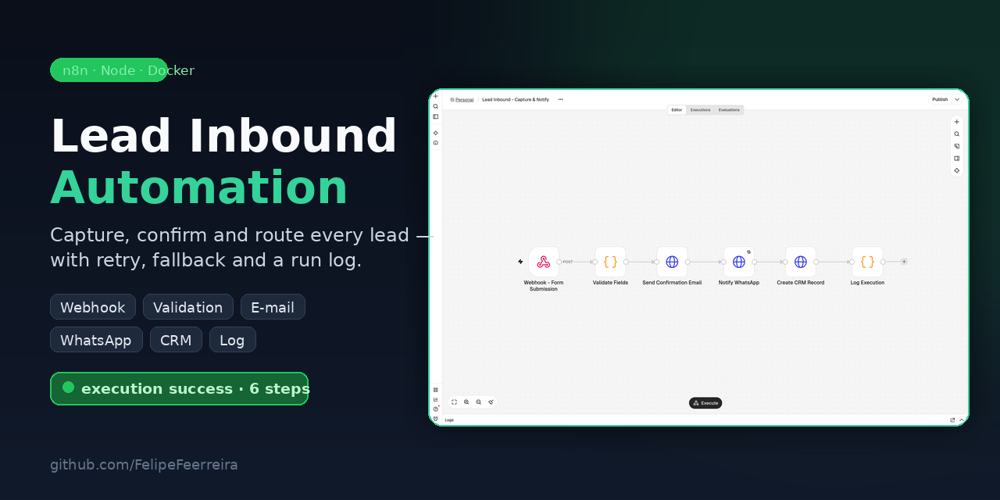
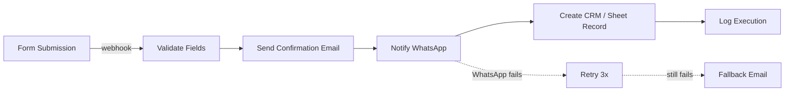

# n8n Lead Automation



A small, production-oriented n8n automation package for capturing inbound leads, confirming by email, notifying by WhatsApp, and recording leads in a CRM or Google Sheet.

This repo contains importable n8n 1.x workflows plus a local, dependency-free Node.js simulator so you can see the full flow running without installing n8n.

---

## What problem it solves

Small businesses lose leads when form submissions sit unnoticed. This workflow:

1. Receives a form submission via webhook.
2. Validates required fields.
3. Sends an immediate confirmation email.
4. Notifies the team (or the lead) via WhatsApp.
5. Stores the lead in a CRM or Google Sheet.
6. Logs the execution status for visibility.

A second scheduled workflow sends follow-up messages to leads who have not replied after 2 days, with retry/backoff and a "sent" mark to avoid duplicates.

---

## Flow diagram



---

## Files

| Path | Description |
|------|-------------|
| `workflows/lead-inbound.json` | Main inbound workflow (webhook → email → WhatsApp → CRM → log). |
| `workflows/followup-d2.json` | Daily scheduled follow-up for leads with no response in 2 days. |
| `simulator/` | Local Node.js simulator with fake providers. |
| `docs/loom-script.md` | 90-second video script for the portfolio recording. |

---

## Required environment variables

All credentials are placeholders. Set these in n8n before activating the workflows:

```bash
# SMTP (used by the emailSend node)
EMAIL_FROM=noreply@yourdomain.com

# WhatsApp generic HTTP API (Evolution API, WPPConnect Cloud, etc.)
WHATSAPP_API_URL=https://api.example.com/v1/messages/send

# CRM or Google Sheets HTTP endpoint
CRM_SHEET_URL=https://api.example.com/crm
```

In n8n, attach real credentials to the credential placeholders:

- `SMTP_CREDENTIAL_PLACEHOLDER` → SMTP account
- `WHATSAPP_TOKEN_PLACEHOLDER` → HTTP Header Auth token
- `CRM_TOKEN_PLACEHOLDER` → HTTP Header Auth token / API key

No real credentials are stored in this repository.

---

## How to import into n8n

1. Open your n8n instance (cloud or self-hosted 1.x).
2. Go to **Workflows** → **Import from File**.
3. Select `workflows/lead-inbound.json` or `workflows/followup-d2.json`.
4. Replace credential placeholders with real credentials.
5. Fill in the environment variables above.
6. Activate the workflow.

---

## How to run the simulator

Requires Node.js 20+.

```bash
cd simulator
npm run sim
```

To see the WhatsApp failure + email fallback scenario:

```bash
npm run sim:fail
```

The simulator prints a structured JSON log per step (`timestamp`, `runId`, `step`, `status`, `latencyMs`, `payload`, `note`) and a final summary.

---

## Honest limitations

- This is a portfolio proof of concept. Providers are fake inside the simulator.
- Real WhatsApp, email, and CRM integrations require valid credentials and endpoint URLs.
- The follow-up workflow assumes the CRM/sheet exposes a queryable `lastContact` field and a `followUpSentAt` field; adjust to your real schema.
- Retry/backoff settings inside n8n nodes are conservative (3 tries, 2 s wait); tune for your provider rate limits.
- No persistence or queueing layer is included; high-volume use would need a real CRM/DB and idempotency keys.

---

## Tech stack

- n8n 1.x
- Node.js 20 (simulator only)
- No runtime dependencies (simulator uses built-in modules only)

## Verified runs (2026-10-27)

Both workflows were executed on a real n8n instance (Docker, n8n latest) with a local mock for e-mail, WhatsApp and CRM.

### lead-inbound — status: success

```text
POST /webhook/lead-form  {"name":"Marina Alves","email":"marina@clinica-exemplo.com","phone":"+5511987654321","source":"landing-page"}
/email    {"to":"marina@clinica-exemplo.com","subject":"Thanks for reaching out","lead":"Marina Alves"}
/whatsapp {"phone":"+5511987654321","message":"Hello Marina Alves, your request was received."}
/crm      {"name":"Marina Alves","email":"marina@clinica-exemplo.com","phone":"+5511987654321","source":"landing-page","status":"new"}
```

### followup-d2 (manual variant) — status: success

```text
GET   /crm/leads?status=new&lastContact__lte=2026-10-25T13:13:43-04:00
POST  /whatsapp {"phone":"+5511900000001","message":"Hi Ana Souza, just checking in on your request. Anything I can help with?"}
PATCH /crm/leads/mock-1 {"followUpSentAt":"2026-10-27T17:13:44.087Z"}
```

Note: the lead with `followUpSentAt` already set was skipped — only one follow-up was sent, which is the deduplication rule working.

Evidence files: `screenshots/01..06`, `run-log.txt`.

### Bugs found by running, fixed

1. `tags` in the exported JSON broke `n8n import:workflow` (removed).
2. Validation code read the webhook payload at top level; newer n8n delivers it under `body`.
3. HTTP nodes carried `authentication: genericCredentialType` pointing to placeholder credentials that do not exist.
4. After the e-mail node, downstream nodes lost the lead fields — expressions now read `$('Validate Fields').item.json`.
5. The follow-up filter assumed one item with an array inside; it now flattens `$input.all()`.

### How to run the production webhook

Import the workflow, then activate it from the canvas (Publish). The production URL `/webhook/<path>` is only registered after activation through the UI.
